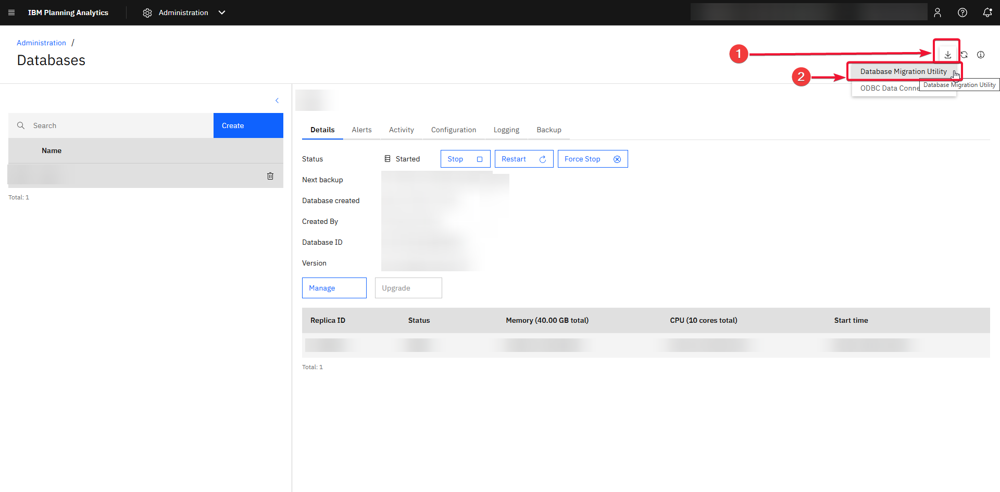

# TM1 v11 → TM1 12: the migration guide

Created by Muhammad Eissa, Cubewise — [meissa@cubewise.com](mailto:meissa@cubewise.com).

This guide is for the consultant who moves a Planning Analytics v11 model to **TM1 12**, on PA as
a Service or a local TM1 12 install. It covers the whole route: what breaks, what to prepare, how
to run IBM's migration utility, and what to check afterwards.

The **TM1 12 Readiness** plugin for Arc does the finding and most of the fixing
(**Tools → TM1 12 Readiness**). Each section below says which tab to use.

**Projects (optional).** The *Project (optional)* field, first in the bar beside *Database*,
starts a project in a folder you pick, or continues one. The folder keeps the scans, step status,
results, the migrate.log you read, the action log and the backups. With a project open, backups go
into its `backups/` folder instead of Downloads. A scan reopened from a project is shown at once
and refreshes itself from the database; Apply stays disabled until the fresh scan is in, because
Apply builds from the code a scan captured.

It draws on three sources:

- IBM's own documentation (PA 3.1 / TM1 12 and PA 2.1 / v11);
- field experience;
- **measurements made against a live TM1 12.6.4 database**, marked *(measured)*.

Where IBM's lists and the TM1 12 compiler disagree, the compiler wins, because the compiler decides
whether a process survives.

Every example uses **GO_New_Stores**, IBM's TM1 sample model, which ships with a local TM1 (Planning Analytics) installation.

---

## Contents

1. [How the migration works, and what it does not do](#1-how-the-migration-works-and-what-it-does-not-do)
2. [Step 1: Assess](#2-step-1--assess)
3. [Step 2: Prepare the v11 model](#3-step-2--prepare-the-v11-model)
4. [Step 3: Size and convert](#4-step-3--size-and-convert)
5. [Step 4: Create and restore the TM1 12 database](#5-step-4--create-and-restore-the-tm1-12-database)
6. [Step 5: Verify on TM1 12](#6-step-5--verify-on-tm1-12)
7. [Step 6: Parallel run and cutover](#7-step-6--parallel-run-and-cutover)
8. [Reference: TI functions](#8-reference--ti-functions)
9. [Reference: MDX](#9-reference--mdx)
10. [Reference: control objects](#10-reference--control-objects)
11. [Reference: tm1s.cfg](#11-reference--tm1scfg)
12. [Reference: files, ODBC, REST, security](#12-reference--files-odbc-rest-security)
13. [Tips and gotchas](#13-tips-and-gotchas)

---

## 1. How the migration works, and what it does not do

IBM's **Database Migration Utility** (`migrate_tm1`) reads a v11 data directory and writes one
backup file (`.tgz`). You then upload that file to PA as a Service and restore it as a new
database. The utility converts the **whole** database in a single pass, and **it fixes
nothing**:

- **A process that calls a function TM1 12 does not have is carried over broken.** The utility
  reports it on an `error` line, *"Issue(s) found during TI Process migration"*, and on TM1 12
  it does not compile or run until it is fixed. On the GO_New_Stores demo model, **41 of 159
  processes** are in that state *(measured: the utility's own log names exactly the 41 the scan
  predicts, 22 of them in TM1 Applications)*.
- **Clients migrate according to `CloudID`.** Once a `CloudID` element exists in
  `}ClientProperties`, only clients with a value are migrated, and every other client is
  dropped (§3.4).
- **Some objects never migrate:**
  - sandboxes;
  - names that are not valid UTF-8;
  - cube, view, dimension and subset names containing `\ / : * ? " < > | ' ; ,`;
  - data files in client directories;
  - cube locks.
- **A leaf element that is N in one hierarchy and C in another rejects its dimension, and the
  utility stops at the first one.**
- **MDX that v11 accepted can fail, or silently return nothing, in TM1 12** (§9).

The work is therefore a loop:

> **scan v11 → fix → run the utility → read the log → fix → run again**

The plugin runs the scan and applies the fixes. It also has a **v12 compile check** that
dry-runs every v11 process against a real TM1 12 compiler before you ever run the utility.

---

## 2. Step 1 — Assess

**Plugin: step 1 on the Overview.** Pick the v11 database in **Database** and click **Scan model**.

- **Read the numbers first:**
  - processes that will not compile on TM1 12;
  - findings that break after migration;
  - findings the plugin can fix.

  TM1 Applications processes (`}tp_*`) are counted separately, because they are a different
  decision (§3.2).
- **Connect a TM1 12 database in Arc and run the v12 compile check** (step 1's **Compile check**
  row, then **Run v12 compile check**). It sends each v11 process's code to the TM1 12 compiler as
  a dry run, so nothing is created there. A process the TM1 12 compiler rejects migrates but will
  not run on TM1 12. The check also catches anything a
  list of function names misses. Allow about 4 seconds per process on PA as a Service.
- **Inventory what lives outside the model**, because the scan cannot see it:
  - Windows scheduled tasks and cron jobs;
  - `TM1RunTI` callers;
  - TM1py and other REST scripts;
  - Cognos Command Center jobs.
- **Legacy clients.** Architect, Perspectives, TM1 Web / websheets, Performance Modeler,
  Cognos Insight and TM1 Applications do not connect to TM1 12. Only the OData REST API
  remains; the C, Java and .NET APIs are gone. **PAfE must be 2.0.77 or later.**
- **ODBC sources** need the ODBC Data Connector (§12.2), which is an infrastructure task with
  lead time. Start it early.
- **`tm1s.cfg`.** 149 parameters are not supported in TM1 12 (§11). On PA as a Service,
  configuration lives in PA Administration. The scan reads the server's configuration and shows it
  in step 3 on the Overview: red when `DatabaseDirectory` is missing, which stops the utility (§4).

---

## 3. Step 2 — Prepare the v11 model

**Plugin: step 2 on the Overview, in its order.** TM1 Applications (§3.2) and unused Bedrock
(§3.6) are deleted first, then the remaining findings are fixed (§3.1), then CloudID (§3.4) and
the data-file plan (§12.1). Deleting first saves work: every object deleted is one fewer to fix.
The user guide's *Step 2* shows each tab.

**Skipping a finding** you have decided to leave (the eye icon on its row, or *Skip this finding*
in its panel) takes it out of the list, the counts and the tiles, and **Apply leaves its statement
as it is**, while still fixing the others in the same process. Skips are kept per database in this
browser, and in the project when one is open, so they survive a reload and a rescan. *Show skipped
(N)* brings them back to un-skip, and the CSV export marks them. A skipped statement that reads a
variable the fix removes would no longer compile, so the plugin refuses that fix rather than
half-apply it.

**The Fix column.** **REMOVE** comments the statement out, with its dependency chain. **REWRITE**
is a mechanical replacement, shown as a diff. **STUB** comments the statement out and adds a
commented replacement to complete later. **MANUAL** is advice only: nothing is written. **DATA**
writes cube or dimension values (CloudID). **CONFIG** is a report only (`tm1s.cfg`). **ON TM1 v12**
means nothing changes on v11: after the restore, the Data files tab uploads the file and points the
process at it (§12.1). These are counted on their own (*"28 ON TM1 v12"* on GO_New_Stores), neither
fixable here nor hand work. A process that sets its data source in code stays MANUAL, because the
tab cannot change code.

### 3.1 How Apply works, and what it costs v11

Apply writes to the **live v11 model**, in this order:

1. **Back up** the original of every object in the run, as a JSON file in your Downloads
   folder, or the project's `backups/` folder when a plugin project is open. The Backups tab
   restores from that file.
2. **Dry-run compile** the fixed code on v11, and on the TM1 12 target too if one is selected.
   A process that would not compile is never written.
3. **Write** only the procedures that changed.
4. **Read the process back** and compare it with what was sent.
5. **Compile** what was saved.
6. **Put the original back** if any step after the write fails.

A bulk run stops at the first failure.

**Deleting a process instead.** A process nobody needs is better deleted than fixed. The
detail panel of any process finding has **Delete this process**:

1. The plugin scans the model again, so the check uses the model as it is now.
2. It looks for everything that calls the process: an `ExecuteProcess` / `RunProcess` with the
   name written out, a name built from literals that makes this one, a string naming it
   (`sProc = 'name';`), and a chore task.
3. **While any of those exist, the delete is refused**, and they are listed with their lines.
   Fix or remove the calls first.
4. A computed call that *might* be this process is shown as a warning, not a refusal.
5. The whole process is backed up, deleted, and confirmed gone with a 404. The Backups tab puts
   it back.

The check cannot see callers outside TM1, such as PAW action buttons, TM1py or scheduled tasks.

In the Findings list, **TM1 Applications** (`}tp_*`) and **Bedrock** findings link to their own
tabs: those are handled there as a whole, not fixed one by one.

A fix is made **in v11 before cutover**, so it changes v11 behaviour until then. Each finding
says how, for example:

| Fix | What v11 gives up until cutover |
|---|---|
| `CubeSetLogChanges` / `CubeGetLogChanges` commented out | the process no longer turns transaction logging off during a load, so it logs more and may load more slowly |
| `SaveDataAll` / `CubeSaveData` commented out | data is saved at the next scheduled save, not at the end of the process |
| `RefreshMDXHierarchy` commented out | MDX hierarchy metadata is refreshed when TM1 next does it, not at that line |
| writes to `}HierarchyProperties` commented out | the level names these writes set are no longer maintained by this process |

**Why a v11 guard does not work.** The TM1 12 compiler rejects an unknown function wherever it
appears, **even inside `IF(1=0)`** *(measured)*. The only way to keep such a call is to keep it
out of the code that migrates.

**Why fixes cut chains, not lines.** Commenting out
`OldCubeLogChanges = CubeGetLogChanges('product');` but leaving
`CubeSetLogChanges('product', OldCubeLogChanges);` fails to compile with *Variable is
undefined* *(measured)*. The plugin follows each variable through all four procedures and
removes everything that depends on a removed call. If such a use sits in an `IF` or `WHILE`
condition, the process cannot be fixed without changing its structure. The scan then tags all of
that process's findings MANUAL, does not count them as fixable, and lists in the panel the lines
that block the fix, rather than half-fixing it.

The fixed GO_New_Stores `import_Products` **compiles on TM1 12.6.4**; the original fails at
Prolog line 40 *(measured)*.

**What each automated fix has been shown to do.** Each fix was taken all the way through on a copy
of GO_New_Stores: applied on v11, converted by the migration utility 12.6.4, restored on PA as a
Service, then run there. A finding's panel shows its level, and `fix-catalogue.json` in the plugin
folder has the same records.

| Level | Meaning |
|---|---|
| L1 | The fixed process compiles and runs on v11, with no failure the original did not have. |
| L2 | The utility no longer reports it. |
| L3 | It compiles on TM1 12. |
| L4 | It runs on TM1 12 with the same outcome as on v11. |
| L5 | It gives the same result as v11. Cube data was compared, or a test process checks the value itself. Where the platform takes the effect over, the IBM source is named. |

| Fix | Level | Shown on |
|---|---|---|
| `CubeSetLogChanges`, `CubeGetLogChanges` (with their chain), `RefreshMDXHierarchy` — comment out | L5 | the model's own processes |
| writes to `}HierarchyProperties` and `}CubeProperties` — comment out. Both cubes are absent on TM1 12 *(measured)*. Set `MeasuresDimension` once as a cube property afterwards. | L5 | the model's own processes |
| file data sources — the Data files tab (§12.1) | L5 | the model's own processes |
| a name split across a line break — join the lines | L5 | a test process written for the case |
| `CubeSaveData`, `LockOn` / `LockOff`, `BatchUpdateStart` / `BatchUpdateFinish`, `EnablePersonalWorkspace` — comment out | L4 | test processes written for each case |
| `ExecuteCommand` — stub. The process runs, but without the command until the stub is completed. | L4 | a test process written for the case |
| TM1 Applications delete (§3.2) | L2 | the model's own `}tp_` objects |

**One effect of migration, not of any fix.** TM1 12 rebuilds feeders from the rules, because old
feeder files are not migrated. A rule-calculated cell that only an old feeder file kept fed keeps
its value, but **a NON EMPTY view no longer shows it**. On GO_New_Stores, 120 cells of *New Store
Index* (a `DIMIX` rule with no feeder) read the same on both versions, but drop out of NON EMPTY on
TM1 12 *(measured)*. Check such rules for a missing feeder before cutover.

### 3.2 TM1 Applications (`}tp_*`)

**Plugin: TM1 Applications tab.**

TM1 Applications (Contributor) does not exist in TM1 12. On GO_New_Stores, 125 of 159 processes
are `}tp_*`, and 22 of them would migrate without compiling. They are **one decision, not 125 fixes**:

- **If the application is retired**, delete every `}tp_*` object before migrating.
- **If the workflow is still needed**, redesign it in PAW (workflow, tasks) after cutover.

**What the tab deletes.** Every object whose name starts `}tp_`:

- chores (and any chore whose every task runs a `}tp_` process);
- processes;
- views and subsets named `}tp_*`;
- cubes and dimensions.

It also deletes the control objects TM1 keeps for them, which carry `}tp_` after a prefix of
their own: `}ElementAttributes_}tp_config`, `}CellSecurity_}tp_…`, `}Subsets_}tp_…`,
`}Views_}tp_…`. On GO_New_Stores that is **168 objects**: 125 processes, 7 cubes, 17 dimensions
and 19 control objects *(measured)*. Some of those are orphans of per-application objects that no
longer exist, such as `}Subsets_}tp_tasks}<guid>`.

**How it runs.**

1. Every object starts selected; untick any you want to keep.
2. The right-hand panel lists what **outside** TM1 Applications still points into it:
   - a process that runs a `}tp_` process or names a `}tp_` cube;
   - rules that read a `}tp_` cube;
   - a cube built on a `}tp_` dimension;
   - MDX that names one;
   - a chore with a `}tp_` task among others.

   Those objects break once the application is gone, so change or retire them too.
3. **Back up, then delete.** The plugin first reads everything it needs to restore each object
   and saves it as a backup (Downloads, or the project's `backups/` folder):
   - process definitions, in full;
   - chores with their tasks;
   - cube dimensions, rules and cells;
   - dimension elements, edges, attributes, attribute values and subsets.

   **If any part cannot be read, nothing is deleted**, with one exception. TM1 refuses to let anyone,
   Admin included, read the cells of some TM1 Applications cubes: 9 of the 13 on GO_New_Stores
   *(measured)*. Those cubes are listed, backed up without their cells, and deleted only after you tick
   a box. A restore brings them back empty.
4. It deletes in dependency order (chores, processes, views, subsets, cubes, dimensions, then
   control objects) and carries on past a refusal. It stops, deleting nothing more, on a sign-in
   error (401/403) or on two answers in a row that did not come from TM1; the backup holds
   everything. Each outcome is listed, and a 404 on a control
   object counts as done: TM1 removes most of them with their parent.
5. The model is scanned again, so anything left behind shows up.

**Restoring.** The Backups tab puts the objects back: dimensions, then cubes and their data,
then subsets, views, processes and chores. A cube's rule-calculated cells are not in the backup,
because the rules come back with the cube and recalculate them. A native view and the control
objects are not restored: TM1 recreates the control objects with their parent, and a native view
has to be rebuilt by hand from the backup file. **Measured on scratch `}tp_` objects on
GO_New_Stores:** a cube with rules and data, two dimensions with an attribute, a consolidation,
a subset and a process. Deleting them left seven 404s. The restore brought back every element,
edge, attribute value, rule, cell and parameter, each checked by an independent read.

### 3.3 Objects and files

- **Rename** any cube, view, dimension or subset whose name contains
  `\ / : * ? " < > | ' ; ,`, together with every reference to it.
- **Element-type conflicts.** An element that is N in one hierarchy and C in another rejects the
  dimension, and the migration stops. The log shows *"Element's type conflicts with previously
  encountered element"*.
- **Delete or repair views** that reference elements that no longer exist.
- **Source files.** TI in TM1 12 can reach only the database's own content area, and the utility
  ignores directories outside `DatabaseDirectory`. On GO_New_Stores, **28 processes** read a file
  TM1 12 cannot reach: 22 from `../translation files/…`, 5 from `../sourcefiles/common/…` and one
  from an absolute `D:\…` path *(measured)*. Such a data source is tagged **ON TM1 v12**, and there
  is nothing to change on v11: after the restore, the Data files tab uploads each file and points
  the process at it (§12.1). A path written in the code (`AsciiOutput`, `DatasourceNameForServer`…)
  is MANUAL: change it to a relative path, because absolute (`C:\...`) and UNC (`\\server\...`)
  paths never work in TM1 12.
- **Old feeder files.** The utility's README (step 8) says to start the model on a recent v11
  release and save data, so that TM1 writes the feeder files in the format the utility expects.
  On GO_New_Stores (11.8) a `SaveDataAll` did not rewrite them, and the utility still reported the
  old format *(measured)*. TM1 12 then rebuilds the feeders from the rules: check rules with no
  feeder before cutover (§3.1).
- **Use forward slashes in TI paths.** TM1 12 runs on Linux, so `data\sales.csv` becomes
  `data/sales.csv`. This matters most for a model that comes from Windows.

### 3.4 Security: CloudID

**Plugin: CloudID tab, on the v11 database.** On TM1 12 the tab reads and writes nothing.

The utility decides which clients to migrate by reading one element:

1. Add an element **`CloudID`** (String) to the **`}ClientProperties`** dimension.
2. In the `}ClientProperties` cube, give every client that should migrate its **new TM1 12
   name**.

The rules the utility applies:

- **When `CloudID` exists, only clients with a value migrate.** Their private views and subsets
  move with them, under the new name. **Blank clients are dropped, and so are their private
  objects.**
- **When the element does not exist,** every client migrates under its current name.
- **Admin's private objects move only if Admin has a CloudID.**
- **IBM does not specify the value format.** It says only that the name must align with the new
  authentication framework. In practice that is the user's IBMid, usually an e-mail address.
  On a live PA as a Service database, `}Clients` holds a mix of e-mail-shaped and short names
  *(measured)*.

The plugin creates the element, after a confirm that spells out the rule above. You then fill
the values in one of three ways:

- edit them in the grid;
- export a CSV with a blank CloudID column, have it filled in, and import it back;
- import any `client,CloudID` file. `;` separators (Excel in many locales) and UTF-8 with BOM
  are handled.

Before anything is written, it reports:

- duplicates (two clients would become one), which block the import;
- blanks;
- Admin without a value;
- values that do not look like e-mail addresses (a warning only).

Every write is backed up first.

**Clients whose names are CAM IDs.** The utility's `--extract-cam-emails` option turns
`CAMID("<namespace>:u:name@example.com")` into `name@example.com` as the TM1 12 client name.
Use it instead of typing a CloudID for every CAM client.

**Groups: `}GroupProperties`.** Groups can be chosen and renamed the same way. TM1 does not have
the objects, so they are created first:

1. Create a **`}GroupProperties`** dimension with a **`CloudID`** (String) element.
2. Create a **`}GroupProperties`** cube dimensioned `}Groups` × `}GroupProperties`.
3. Give every group that should migrate its new TM1 12 name in the `CloudID` cell.

Once the mapping exists, only mapped groups migrate, under their new names. Without it, every
group migrates under its current name. **`ADMIN`, `DataAdmin`, `OperationsAdmin` and
`SecurityAdmin` are always created**, whatever the mapping says. The CloudID tab's **Groups**
section creates the objects and fills them in, like clients.

**After migration,** re-apply security in TM1 12: cube and element security, and anything
CAM-specific. `}ClientProperties` does not exist in TM1 12 *(measured)*.

### 3.5 ODBC, ExecuteCommand, chores, e-mail

- **ODBC:** see §12.2.
- **`ExecuteCommand`** does not exist. Replace it with `ExecuteHttpRequest` calling an external
  service (Azure Function, AWS Lambda, a container) that does the work. The plugin comments out
  the call and leaves a commented `ExecuteHttpRequest` template beside it. The template can only
  be completed **after** cutover, because `ExecuteHttpRequest` does not exist in v11 and IBM
  back-ports no TM1 12 function to v11.
- **Chores** are rebuilt in PAW.
- **E-mail** goes through an external service, such as Microsoft Graph, called with
  `ExecuteHttpRequest`.

### 3.6 Bedrock

**Plugin: Bedrock tab.**

**Bedrock 5** ([github.com/cubewise-code/bedrock-5](https://github.com/cubewise-code/bedrock-5))
is the Bedrock release for TM1 12, and it does not run on v11. So **the upgrade happens
on the TM1 12 database, after migration.** On v11 the tab shows what will happen.

**Delete the unused ones on v11, before migrating.** Bedrock 4 calls functions TM1 12 does not
have, such as `CubeSetLogChanges`. So every Bedrock 4 process migrates only to fail to compile
on TM1 12. One that nothing uses is not worth upgrading, but it would still show up there as a
broken process to explain or clean up. Deleting it on v11 means it never arrives. The ones in
use are upgraded on TM1 12.

**What counts as Bedrock.** A process named `}bedrock.*` is Bedrock 4 or 5. A process named
`bedrock.*`, without the brace, is Bedrock 3.

**Is it Bedrock 5?** The tab loads the Bedrock 5 code and compares each process with it.

- **Where the code comes from.** GitHub is the default; the copy bundled with the plugin
  (pinned to a commit) works offline.
- **What is compared.** The four procedures and the parameters. Line endings and TM1's
  regenerated "Generated Statements" block are ignored.
- **The version text is only shown.** "Code says" displays what the Prolog claims (`Ver 4.0`, or
  `5` when it names `bedrock-5`), but that text is unreliable in both directions *(measured)*:
  - 14 of Bedrock 5's own 97 processes never mention `bedrock-5`, and two still say `Ver 4`;
  - 88 of the 91 processes in the Bedrock package for v11 (`bedrock-v11.json`) do mention it.

Opening the tab loads Bedrock 5 from the chosen source straight away.

**The status column.** Above the table, one chip per status present shows how many rows have
it. Hover a chip, or a status in a row, for its meaning; click a chip to show only those rows,
and click it again to show all. The same chips and hover texts are on the Findings tab (one per
severity) and on the Overview tiles, where a click opens the list behind the number.

| Status | Meaning |
|---|---|
| **Bedrock 5** | The code is the same as Bedrock 5's. Nothing to do. |
| **not Bedrock 5** | Older or locally changed code. **Upgrade** replaces it with Bedrock 5, after a backup. |
| **Bedrock 3** | An old `bedrock.*` name. Its Bedrock 5 successor is shown under it; install that, and change the callers by hand. |
| **not in Bedrock 5** | A `}bedrock.*` name Bedrock 5 does not have: a custom process with the Bedrock prefix, or a retired one. It is only ever left or deleted. |
| **not compared** | Bedrock 5 is not loaded (for example, GitHub cannot be reached). Nothing is claimed; choose the bundled copy. |
| **missing** | A process in use calls it, and the database does not have it. **Install** adds the Bedrock 5 version (TM1 12 only). |
| **fails on TM1 12** / **will not compile on 12** | The process calls a function TM1 12 does not have, such as `CubeSetLogChanges`, which Bedrock 4 uses. It migrates, but it does not compile on TM1 12. Hover the pill for the functions. The Bedrock 5 version does not call them, so **Upgrade** fixes it on TM1 12. |

**"Suggested action"** sets every row back to the tab's suggestion: upgrade what is in use and
not yet Bedrock 5, delete what nothing uses, and leave the rest.

**Is it used?** A Bedrock process is in use when a **business process** (anything that is not
Bedrock) or a **chore** runs it:

- directly;
- or through other Bedrock processes that are themselves in use.

A call from a Bedrock process that nothing uses does not count. A call is:

- an `ExecuteProcess` / `RunProcess` with the name written out;
- or any string naming a Bedrock process, as in `sProc = '}bedrock.cube.data.clear';`, which
  is how Bedrock calls itself.

After an upgrade the Bedrock 5 code does the calling, so its calls count as well.

**Computed process names.** A business process that runs `ExecuteProcess(sProc)` might run a
Bedrock process without naming it. The tab follows `sProc` to where it is set:

- A variable set only from literals is resolved.
- A name built from a literal start that no Bedrock name has, such as `'import_' | sCube`, is
  known not to be Bedrock.

Only what is still open is listed: a parameter, a value read from a cube, or a start that could
be Bedrock. Each is shown with its line. **A listed call does not mean the process uses Bedrock;**
it means the code alone cannot say. It cannot see callers outside TM1 either, such as PAW action buttons or
TM1py scripts.

**What it proposes.**

| Row | Proposal |
|---|---|
| in use, not Bedrock 5 | **Upgrade** (TM1 12 only) |
| nothing uses it | **Delete** |
| already Bedrock 5, and in use | Leave |
| a Bedrock 5 process that callers need and the database lacks (the utility may have left it out) | **Install** (TM1 12 only) |
| Bedrock 3, in use | Leave; install its Bedrock 5 successor, and change the callers by hand |

Every row can be changed. **Set every row to** switches them all at once. A Bedrock library that
people run by hand from Arc or PAW has no callers in the model, so it is proposed for deletion:
set it to **Upgrade** instead if it should stay.

**Callers.** From Bedrock 4 to Bedrock 5 *(measured)*:

- Every process gained `pJson`, which needs nothing from a caller.
- `}bedrock.cube.data.copy` lost `pStringPrefix` and `pStringSuffix`.
- 34 processes changed 48 defaults between them: `pDelim` from `,` to `&`, `pSuppressConsolStrings` from
  `0` to `1`, `pCharacterSet` to `TM1CS_UTF8`, and others.

With **Update callers automatically** (the default), every business process and chore that
calls an upgraded or installed process gets two changes:

- **A removed parameter is dropped** from the call.
- **A changed default it relied on is passed explicitly with its old value**, so the caller keeps
  the behaviour it had.
- **A chore task also gains every parameter that is new in Bedrock 5** (`pJson`), with its
  default. TM1 12 refuses a task that does not list every parameter of its process
  *(measured)*.

Each changed statement gets a `# SAASMIG Bedrock 5 …` line above it saying what changed. The panel
shows every change as a diff before anything runs.

A call to a **Bedrock 3** process is never rewritten, because its successor takes different
parameters; it is listed for a person to change. Neither is a call whose parameter names are
computed.

**How it runs.** It follows the same safety sequence as Apply:

1. Back up every process it touches.
2. Dry-run compile the Bedrock 5 code on the TM1 12 database.
3. Write it: a PATCH for an upgrade, a POST for an install.
4. Read it back; it must match the Bedrock 5 code.
5. Compile what was saved.
6. If anything fails after the write, put the original back.

Callers of a process whose upgrade failed are left alone. Unused processes are deleted last,
and each deletion is confirmed with a 404.

---

## 4. Step 3 — Size and convert

**The plugin prepares; IBM's utility converts.** The plugin gets the v11 model ready, but it does
not produce the file you upload. **IBM's Database Migration Utility** does that: it converts the v11
data directory into a valid TM1 12 backup file, which you upload and restore (§5).

- **Disk and RAM.** The utility needs free disk of **at least 2.5×** the database size, plus RAM
  to load it.
- **Where to run it.** IBM says to run it on the machine that hosts the v11 database, to keep
  locale information. **On PA on Cloud that machine is not reachable,** so the practical route
  is a copy of the data directory on another machine. Check the log for locale-related
  warnings.
- **Structure first, data later.** For a large model: restore a copy, clear the cube data but
  keep control-object data, convert that, and move the data separately. This keeps the target's
  RAM needs, and the upload, small.
- **Getting the utility from PA as a Service.** This is the easiest route, and it gives the
  version that matches your cloud environment.
  1. Sign in to Planning Analytics on the cloud and open **Administration → Databases**.
  2. At the **top right** of the Databases page, click the **download icon** (the arrow into a
     tray, to the left of the refresh and info icons).
  3. From the menu that opens, choose **Database Migration Utility**. The download is a `.tgz`;
     unpack it with `tar xf <file>.tgz`, which works in Git Bash on Windows.

  The same menu offers the **ODBC Data Connector** (§12.2).



- **Getting it from Passport Advantage.** The alternative is `migration-tool-<version>.zip`,
  which contains a Windows zip and a Linux tgz, with `bin64\migrate_tm1.exe` inside. Windows
  needs the VC++ 2015 redistributable.
- **`tm1s.cfg`** must contain `DatabaseDirectory=<path>`, relative to the cfg file.
- **Save the data first.** The utility reads the files on disk, not the server's memory: stop the
  v11 service, or run SaveDataAll — step 3's **Save data** row on the Overview does it on the
  selected database (it needs an admin session). Either way no file is in use while the utility
  reads the data directory (README step 3).
- **The plugin writes the command for you.** After a scan of the v11 database, the **Command** row
  in step 3 on the Overview opens the command for that model, with the folder holding `tm1s.cfg`
  worked out from the server, and **Copy**. Two optional fields fill in the rest, typed because the
  browser cannot see the v11 host's disk: the **Utility folder** (its `bin64`) and the **Output
  folder** for the `.tgz` and the log, which is named `<model>-migrate.log`. With a project open
  whose path on the v11 host is set, an empty output folder means the project's `migration` folder,
  and step 3 then reads the log from there. With neither field, run the command from `bin64`: a
  relative `--output` is written next to the utility, the log next to where you run it
  *(measured, 12.6.4)*.
- **Run it:**

```
migrate_tm1 --input <folder containing tm1s.cfg> --output <file.tgz> [--temp-dir <dir>] [--log-to-file <file>]
```

  The working area is a `tm1-migration` folder next to the output file unless `--temp-dir` says
  otherwise, and it needs room for the whole database.

  On Windows, for example (quote every path that has a space; the output folder is created if
  it is missing):

```
"C:\TM1\migration_tool-windows\bin64\migrate_tm1.exe" --input "C:\<model>\configuration" --output "C:\v12 models\<model>.tgz" --log-to-file "C:\TM1\migrate.log" > "C:\TM1\migrate-console.txt" 2>&1
```

- **Prefer the command line to `MigrationUI.exe`.** In a GO_New_Stores test run *(2026-10-02,
  12.6.4)* the UI recorded the run as **Aborted** with *"Unexpected end of JSON input"*, wrote no
  backup, and the output folder it had been given was reported gone afterwards. On the same model and
  machine, `migrate_tm1.exe` wrote a backup on every run (three of three, with and without
  `--continue-on-error`). **Do not point the UI at a folder that holds anything else.**
- **The log** is JSON lines, written to the console and to `migrate.log` (or the
  `--log-to-file` file).
  - `info` is progress.
  - `warn` needs a look. For example, *"Unknown file, copying to file store"* means a file
    under `}Externals` went to the file store.
  - `error` means a component could not be migrated. Most errors stop the run without a backup
    file; a few leave the failing component out (the README's example: two cubes under
    `FailedCube`).

  What a real 12.6.4 run on GO_New_Stores showed *(measured)*:

  - **A process that TM1 12 will not compile is an `error` line**, *"Issue(s) found during TI
    Process migration."*, with the process name and each problem's procedure, line and text
    (*"Unknown function 'CubeSetLogChanges'"*, or a syntax error). The process **still
    migrates**, broken (§3.1).
  - **`ErroredProcess`** in the summary (*"N Objects processed with problems"*) lists the
    processes whose **data-source file was not found** — a `warn` per process, *"processed with
    errors: Data Source Name for Server, filename … not found"*. They migrate; on TM1 12 the Data
    files tab uploads the file and points the process at it (§12.1). It is **not** the list of
    processes that will not compile, but a process can be on both (`import_Products` is): it
    needs the file, and it does not compile until fixed.
  - *"Unable to find the dimension file"* for **`}GroupProperties`** means groups migrate
    without a CloudID (§3.4).
  - *"Unsupported old feeder file format"* means the feeders are not migrated: TM1 12 rebuilds
    them from the rules. A rule-calculated cell that only the old feeder files kept fed drops out
    of NON EMPTY views (§3.1). A `SaveDataAll` on 11.8 did not rewrite the files *(measured)*,
    despite README step 8.
  - *"Subset element not found, ignoring"* means a static subset lists an element its dimension
    no longer has, for example a `}Cubes` subset naming a deleted cube. v11 already leaves that
    element out when it loads the subset, so TM1 12 gets the subset as v11 shows it now: harmless.
    Re-save or delete the subset on v11 to tidy up. GO_New_Stores has 26 *(measured)*.
  - **The log file ends at *"Model … was migrated [with problems]"* and memory used.**
    *"Backup file successfully created!"* and *"Migration has been successfully completed!"*
    are printed **to the console only**. So keep the console output (the `> … 2>&1` above), or
    check that the `.tgz` exists — the log file alone does not say.

  The **migrate.log** row in step 3 on the Overview reads the log file, or the console capture,
  from a file you pick or from the project's `migration` folder. It keeps those two lists apart
  and compares the first with the scan's prediction. On GO_New_Stores the two agree exactly: **41
  processes**, line for line. It opens with a verdict: *Clear to go*, *Step 4 can start, with N
  things to do*, or *Not ready for step 4*. Each line carries a tag:

  | Tag | What it covers |
  |---|---|
  | **Stops step 4** | the run did not finish (no closing *"Model … was migrated"* line); a cube that did not migrate (`FailedCube`); an `error` line not tied to a process |
  | **To do** | processes that will not compile (fix on v11 and convert again, or with Apply on TM1 12); a process the scan did not predict (scan again); `}GroupProperties` missing (groups go without a CloudID: CloudID tab); old feeder files (check rules with no feeder, §3.1); no proof the `.tgz` was written |
  | **On TM1 v12** | processes whose data-source file was not found: the Data files tab fixes them after the restore (step 5) |
  | **Nothing to do** | subset elements not found; the `.tgz` found in the project's folder |
- **Fix what the verdict marks *Stops step 4* or *To do* in v11, and run the utility again.**
  *On TM1 v12* lines wait for step 5.

---

## 5. Step 4 — Create and restore the TM1 12 database

On PA as a Service:

1. In PAW, as a user with the Administrator role, go to **Administration → Databases**, pick
   the environment, and **Create**.
2. Give the new database **exactly the v11 database name**. Database names are case-sensitive
   in TM1 12 and cannot be changed later. PAfE and websheet references depend on the name.
3. Give it at least the v11 RAM and CPU. Set replicas, backups and backup time now.
4. Go to **Backup → Upload database backup** (`.tgz` / `.tar.gz`). **The upload performs no
   validation.**
5. Choose **Restore**.

A local TM1 12 install restores the same `.tgz`; its steps are not covered by a measurement here.

Then, in Arc and the plugin:

1. Connect the new database in Arc.
2. In the plugin, on the v11 database, pick it in step 4's **TM1 12 database** row. The row checks
   the version: a v11 database, or one not signed in, is named as such. Then choose **Switch to it
   and scan**. The TM1 12 database becomes the page's database, the v11 database becomes the
   comparison, and a project records both. The plugin scans it and lands on the Data files tab
   when files are still to upload, otherwise on step 5.

---

## 6. Step 5 — Verify on TM1 12

**Plugin: step 4's hand-off has already scanned the TM1 12 database (§5).** Step 5 on the
Overview lists: Compare with v11, Compile check, Bedrock, Data files.

- **Processes that do not compile.** Run the compile check on the TM1 12 database: every
  process that migrated with a removed function fails there. Fix them on TM1 12, or better, fix
  them on v11 and migrate again.
- **Missing objects.** Anything present in v11 and missing in TM1 12 was not migrated: a
  rejected name, a rejected dimension, a failed cube. The compare lists them.
- **Bedrock.** Open the Bedrock tab on the TM1 12 database (§3.6). It upgrades the Bedrock
  processes in use to Bedrock 5, installs the ones callers need that the database lacks,
  updates those callers, and deletes the ones nothing uses.
- **MDX.** Open every dynamic subset and MDX view. The dangerous case is **a subset referenced
  by identifier (`[dim].[hier].[subset]`)**: it returns **an empty set with no error** in TM1
  12 *(measured)*, so nothing warns you. The fix is `TM1SubsetToSet` (§9).
- **Chores.** Rebuild them in PAW, then check their schedules and time zones.
- **Files.** The scan shows *"N ON TM1 v12 to do"* and **Upload data files (N)**. The Data files
  tab uploads each file and points its process at it, and the findings close on the next scan
  (§12.1). A path written in code is changed by hand.
- **Control objects.** Delete `}Capabilities`, because the utility does not, and it has no
  effect. Set the `}CubeProperties` settings as cube properties (§10).
- **Security.** Re-apply groups and element and cell security, and test as a restricted user.
  Element security is applied **before** MDX in TM1 12, and since 12.5 naming an inaccessible
  member is an error.
- **Data.** Validate every cube, at leaf level or at a chosen consolidation for speed, and
  validate the dimensions.
- **Performance.** Re-baseline. v11 tuning does not carry over. `MaximumViewSize` is replaced
  by `MaximumSingleQueryMemorySizeMB` and `MaximumGlobalQueryMemorySizeMB`, both default 0
  (off).

---

## 7. Step 6 — Parallel run and cutover

- Keep v11 running and sync data from v11 to TM1 12 until user acceptance testing signs off.
- At cutover, freeze v11 changes, run the final sync, switch users to PAW and PAfE (2.0.77 or
  later), and retire v11.
- After cutover, complete the `SAASMIG TODO` stubs. These are the `ExecuteHttpRequest`
  replacements for `ExecuteCommand`. They are easy to find with Arc's code search.

---

## 8. Reference — TI functions

### 8.1 Not available in TM1 12: the process migrates, but does not compile

Every name below is **rejected by the TM1 12.6.4 compiler** *(measured: a dry-run compile of
each)*. **Fix** says what the plugin does:

- **Comment out** is automatic.
- **Stub** comments the call out and adds a commented replacement template.
- **Manual** means redesign.

| Function(s) | Fix | Replacement |
|---|---|---|
| `CubeSetLogChanges`, `CubeGetLogChanges` | comment out, with the dependency chain | none; logging is managed by the platform |
| `SaveDataAll`, `CubeSaveData` | comment out | none; persistence is managed by the engine. If a save was a synchronisation point, redesign it with `RunProcess` + `WaitForAllJobs` |
| `CubeUnload` | comment out | none (removed in 12.5) |
| `RefreshMDXHierarchy` | comment out | none documented |
| `BatchUpdateStart`, `BatchUpdateFinish`, `BatchUpdateFinishWait`, `EnableBatchCellIncrement`, `BatchCellIncrement`, `EnableBulkLoadMode`, `DisableBulkLoadMode` | comment out | obsolete with Parallel Interaction; parallelise with `RunProcess` |
| `LockOn`, `LockOff` | comment out | `Synchronized(lockName)` after cutover |
| `SetChoreVerboseMessages`, `SetOdbcUnicodeInterface`, `SubsetFormatStyleSet` | comment out | none |
| `EnablePersonalWorkspace` | comment out | none; personal workspaces belong to TM1 Applications. On no IBM list — found by the 12.6.4 migration utility on GO_New_Stores |
| `ExecuteCommand` | stub | `ExecuteHttpRequest(method, URL, options…)` to an external service |
| `ExecuteJavaN`, `ExecuteJavaS` | manual | none; Java TI is gone |
| `AssignClientPassword`, `AssociateCAMIDToGroup`, `RemoveCAMIDAssociation`, `RemoveCAMIDAssociationFromGroup` | manual | identity lives in the IdP (IBMid / OIDC) |
| `CubeDataReservationAcquire`, `…Get`, `…GetConflicts`, `…Release`, `…ReleaseAll`, and the short forms `CubeDRAcquire`, `CubeDRGet`, `CubeDRGetConflicts`, `CubeDRRelease`, `CubeDRReleaseAll` | manual | PAW workflow / application design |
| `CGAddPromptValues`, `CGPromptGetNextMember`, `CGPromptSize`, `CognosDimension`, `CognosPackage`, `CognosQuery` | manual | Cognos package sources are not supported |
| `AddInfoCubeRestriction`, `DeleteAllInfoCubeRestrictions`, `CubeSetConnParams`, `CubeSetSAPVariablesClause`, `DataSourceAddSAPHierarchy`, `DataSourceDeleteAllSAPHierarchies`, `NWSAPCharacteristic`, `NWSAPInfoCube`, `SAPAttributes`, `SAPCharacteristic`, `SAPCharacteristicTexts`, `SAPCurrency`, `SAPHierarchy`, `SAPInfoCube`, `SAPODSInsert`, `SAPOpen`, `SAPSecurity`, `SAPTable`, `SetCharacteristicAttributes`, `SetCharacteristicHierarchies`, `SetInfoCubeCharacteristics`, `SetInfoCubeKeyFigures`, `SetRoleAuthorizationColumns` | manual | SAP data-source functions are not supported; replace the data source |
| `ODBOCube`, `ODBODimension`, `ODBOMDXQuery` | manual | replace the ODBO source |
| `AllowExternalRequests`, `CreateHierarchyByAttribute`, `CreateMultiHierarchyTestCubes`, `CubeSetIsVirtual`, `CubeSetSlicerMembers`, `ServerShutdown`, `SwapAliasWithPrincipalName` | manual | none (for `SwapAliasWithPrincipalName`, IBM points to localization) |
| `RefreshSecurity` | rewrite | this is not a TM1 function on either version; the real name is **`SecurityRefresh`** |

### 8.2 On IBM's lists but accepted by the 12.6.4 compiler

`ReturnSQLTableHandle`, `ReturnCSVTableHandle`, `EncodePassword` and
`DimensionElementInsertByAlias` compile on TM1 12.6.4 *(measured)*. A process that uses them
migrates, but test it there. Two more need a look:

- `RuleLoadFromFileEx` is unknown to **both** compilers, even though IBM documents it.
- `RuleLoadFromFile` works. Its file must be in the content area.

### 8.3 Behaviour changes

- **File functions.** `AsciiOutput`, `TextOutput`, `AsciiDelete`, `AsciiOutputOpen`,
  `FileExists`, `WildcardFileSearch`, `SetOutputEscapeDoubleQuote` and
  `DatasourceNameForServer` work only inside the database content area.
  - Output creates missing sub-folders.
  - `~/` is the user's Home area; `^/` is the Session area.
  - Names are case-sensitive.
  - No BOM is written.
- **TI error logs.** A process started over HTTP or by a chore always writes one. Child-process
  errors are merged into the parent's log. From 12.5 the logs are `.jsonl`, and a whole
  `ExecuteProcess` chain writes one file.
- **TM1 12 only.** `ExecuteHttpRequest` and `HttpResponseGetStatusCode` / `…GetHeader` /
  `…GetBody`, the JSON and JWT functions, `Base64Encode`, `URLEncode`, and `WaitForAllJobs`,
  `WaitForAnyJobs`, `GetJobStatus`, `CancelJobs`. The v11.8 compiler rejects them
  *(measured)*, so they are written **after** cutover.
- **`RunProcess`** exists in both versions and returns a job id. `ExecuteProcess` is unchanged
  apart from logging.
- **`TM1User`** is documented identically for v11 and TM1 12. A comparison with a literal user
  name breaks when names change through CloudID. Prefer a group or attribute test.
- **A name split across a line break.** v11 joins the lines of a statement with nothing between
  them, so `p` at the end of one line and `ApprovalSubset` at the start of the next read as
  `pApprovalSubset` *(measured on 11.8: that compiles, while `vA B` fails with "Variable va is
  undefined")*. TM1 12 reads two names and rejects the statement as a syntax error. The plugin
  flags it as a BLOCKER, and Apply joins the lines. IBM's own `}tp_incr_deploy_application_security`
  has one.

---

## 9. Reference — MDX

Measured on TM1 12.6.4 unless noted.

| v11 form | TM1 12 result | Fix |
|---|---|---|
| An element that some group cannot read, named in MDX (`DESCENDANTS([d].[h].[Total])`, `TM1DRILLDOWNMEMBER({[d].[h].[Total]}, …)`, `{[d].[h].[X]}`) | **fails or returns nothing** for those groups' users: TM1 12 applies element security *before* the MDX, where v11 filtered the result afterwards. A blank cell in `}ElementSecurity_<dim>` is None. The scan lists the groups (BREAKS in a subset, REVIEW in TI, which usually runs as an admin) | give those groups READ on the named element: the finding's **Grant READ** does it after a backup, then runs `SecurityRefresh`, and refuses when a rule sets the cell (change the rule instead). On a consolidation it grants only to the groups that can read at least one element under it; the others are listed as not granted, because READ would show them the total and nothing below. `}tp_` groups are left out of the finding, with a note: they belong to TM1 Applications, which the migration removes (INFO when they are the only ones). Rewriting to `DESCENDANTS([d].[h].[X])` does **not** help: it names the element too, and fails for the same users (IBM; confirmed by a restricted-user test). Otherwise stop naming it, e.g. `{DESCENDANTS([d].[h].MEMBERS)}`, which returns everything the user can see, or `FILTER` on an attribute that marks the wanted elements |
| `[dim].[element]` where the element is in the default hierarchy **and** another one (also with `.Children` after it) | **error**: *"Member name … is ambiguous"*. v11 took the default hierarchy; an element in one hierarchy only resolves on both | `[dim].[dim].[element]`, which is the default hierarchy on both. Apply rewrites it in a subset and in a single-string MDX in TI |
| `[dim].[hier].[Attribute]` inside a `FILTER` | **error**: *"Expected a member name but found …"*, for string and numeric attributes alike | a string attribute: `[dim].[hier].CurrentMember.Properties("Attribute")`; a numeric one: `…Properties("Attribute", TYPED)`, without which `> 0` silently matches nothing. Apply rewrites it in a subset, and in MDX written as one string inside TI (`SubsetCreateByMDX`, `ViewCreateByMDX`); MDX built from pieces stays manual |
| `[dim].[hier].[Subset]` or `[dim].[Subset]` | **empty set, no error** | `TM1SubsetToSet([dim].[hier], "Subset")`, also inside `StrToSet` |
| `S.Current`, `S.Current.Item(0)` or `S.CurrentMember` inside `GENERATE(S, …)` or `FILTER(S, …)` | **error**. On v11 it is the member being iterated: `GENERATE(d.MEMBERS, {d.MEMBERS.Current})` returns every member | `[d].[h].CurrentMember`, the same result on both versions. **Not `.Item(0)`**, IBM’s advice: that is the first member every time, so 7 members become 1, and a `FILTER` on the name keeps what it should drop |
| `S.Current` outside an iteration | **error**. On v11, `{d.MEMBERS.Current}` is empty, and `{S.Current}` of a named set gives its 2nd member | no equal rewrite: write the member that is meant |
| `[d].[h].[e].AncestorsAll` (a member property) | **an empty set, no error**; inside `INTERSECT` the MDX fails. v11 gives every ancestor, through every parent | `FILTER(TM1SUBSETALL([d].[h]), COUNT(INTERSECT({e}, DESCENDANTS([d].[h].CurrentMember))) > 0 AND NOT ([d].[h].CurrentMember IS e))`: the same set, in dimension order. `Ancestors` and `IsAncestor` follow one parent only |
| `TM1ROLLUP(S1, S2)` | **invalid function**. On v11: for each member of S1, its direct parents and then the member when it is in S2, otherwise the member alone | for a literal S1, per member: `FILTER(FILTER(TM1SUBSETALL([d].[h]), COUNT(INTERSECT({m}, [d].[h].CurrentMember.CHILDREN)) > 0), COUNT(INTERSECT({m}, S2)) > 0), m`. A computed S1 has no rewrite |
| `TM1TupleSize(x)` | **invalid function**. On v11 it is the number of members in the tuple | the number: 1 for a member, n for an n-member tuple |
| `TM1SubsetBasis()` in a subset | **invalid function**; the migrated subset keeps no stored list | the list Architect saved with the subset, as an explicit set: `{TM1SORT({TM1SubsetBasis()}, DESC)}` becomes `{TM1SORT({{[d].[h].[A], [d].[h].[C]}}, DESC)}`. An empty list becomes `{}` |
| `ANCESTORSALL(…)` as a function | **invalid function**, and a syntax error on v11 too: it never worked | write what was meant |
| `TM1SubsetBasis()` in TI | **invalid function**; v11 has no stored list there either | write the set |
| trailing `;`, text after the expression, unbalanced `]` / `)` / `}`, `DIMENSION PROPERTIES` after a set | syntax error (IBM) | remove |
| `.PREVMEMBER` / `.NEXTMEMBER` / `.CHILDREN` around calculated members; `BottomCount` and the other `Bottom*` functions | changed semantics (IBM) | review |
| `TM1IGNORE_BADTUPLES` | ignored from 12.5; bad tuples are ignored by default | remove; use `ERROR_ON_BAD_TUPLE` to force an error |
| an element the user cannot read | **error** from 12.5 (v11 returned a reduced set) | grant READ, or rewrite the anchor |

The plugin finds the first four rows. It rewrites rows two to four (and a trailing `;`); for the
first it offers **Grant READ**. The Apply for a subset writes the new expression and reads it back.

**The removed functions** (`.Current`, `.AncestorsAll`, `TM1ROLLUP`, `TM1TupleSize`): in a subset, a
rewrite is offered only after the page has run it. The page runs the subset’s MDX on v11 (the
scanned database, or on TM1 12 the original v11 database picked for comparison) and the rewritten MDX
on the scanned database, and the two must return the same members in the same order. `.AncestorsAll` in
MDX that TI joins from strings and variables (`vMdx = '…[' | pDim | '].[' | vNode | '].AncestorsAll…'`) is found in
any statement, and the finding gives the corrected statement, with the variables in place, to paste in.
**MDX built over several statements** (`v = '…';`, `v = v | '…';`, then `SubsetCreateByMDX(s, v)`) is
assembled at the call and checked whole, Prolog to Epilog; the finding names the lines that build it
and shows the assembled MDX and its rewrite. A part assigned inside IF or WHILE makes the order an
assumption, so brackets are not checked then. A member named by a variable whose name says subset
(`[' | pDim | '].[' | pSubset | ']`) is REVIEW: if it holds a subset name, TM1 12 returns nothing. With no v11
database to check against, the finding shows the rewrite but stays manual. In TI, `.Current` and
`TM1TupleSize` are rewritten; the other two are shown.

**`TM1SubsetBasis()`** stands for the element list that Architect saved with a subset when its
expression was recorded. TM1 12 does not keep it. The plugin builds the replacement exactly as Arc's
v11 subset editor does when it opens such a subset. It sets the subset's MDX to `{TM1SubsetBasis()}`
for one request, which returns the list, and puts the MDX back. Then it replaces each
`TM1SubsetBasis()` with the elements' unique names joined by `,`; the braces around the call stay.
So `{TM1DRILLDOWNMEMBER({TM1SubsetBasis()}, ALL, RECURSIVE )}` becomes
`{TM1DRILLDOWNMEMBER({[d].[h].[Total]}, ALL, RECURSIVE )}`, the MDX Arc shows on v11. Unlike Arc, the
plugin re-reads the MDX after putting it back. The rewrite is offered only when it returns exactly
what the subset returns on v11:

- **Scanning v11:** the list is read from the scanned database. Apply the rewrite before the
  migration, and the subset arrives on TM1 12 already working.
- **Scanning TM1 12:** the list is read from the original v11 database: the comparison database when
  one is picked, or the one you pick in the finding (*Read the list*), which then becomes the
  comparison database too. The rewrite is checked on TM1 12. Until a v11 database is given, the
  finding stays manual. When an element is named like the subset, it is suggested as a guess.
- **In TI** (`SubsetCreateByMDX`) there is no stored list, and v11 fails it too: write the set
  by hand.

---

## 10. Reference — control objects

| Object | In TM1 12 | What to do |
|---|---|---|
| `}CubeProperties` | not supported | these become REST cube properties: `ViewStorageMaxMemory` (VMM), `ViewStorageMinTime` (VMT), `CalculationThresholdForStorage`, `AllowPersistentHolds`, `Locked`, `MeasuresDimension`, `TimeDimension` |
| `}CubeSecurityProperties` | not supported | these become cube properties: `CellSecurityDefaultValue`, `CellSecurityMostRestrictive` |
| `}DimensionProperties` | not supported | these become dimension properties: `AllLeavesHierarchyName`, `Locked`, `DefaultHierarchy` |
| `}HierarchyProperties`, `}ClientSettings`, `}ConnectionProperties`, `}ClientCAMAssociatedGroups`, `}ApplicationsEntries` | not supported | remove the references. The plugin comments out cell writes to these (not `}ApplicationsEntries`), and also to `}CubeProperties`, `}Capabilities` and `}ApplicationSecurity` |
| `}ClientProperties` | **absent** *(measured)* | v11 only: that is where CloudID goes |
| `}ApplicationSecurity` | not supported | websheets and files have no group security in TM1 12 |
| `}Capabilities` | present but no effect *(measured / IBM)* | delete after migration |
| `}StatsByCube`, `}StatsByClient`, `}StatsByChore`, `}StatsByProcess`, `}StatsByCubeByClient`, `}StatsForServer` | not supported | use the `Metrics()` endpoint |
| `}CellSecurity_*`, `}ElementSecurity_*`, `}CubeSecurity`, `}DimensionSecurity`, `}ProcessSecurity`, `}ChoreSecurity`, `}ClientGroups`, `}ElementAttributes_*`, `}Hold_*` | supported | — |

A `CellPutS` into a cube that does not exist fails **at run time**, not at compile time. The
process therefore migrates, and then fails the first time it runs.

---

## 11. Reference — tm1s.cfg

IBM lists **149 parameters** as not supported in TM1 12. The groups are:

- networking and ports;
- SSL/TLS and certificates;
- `IntegratedSecurityMode` and every LDAP and CAM setting;
- ODBC and Java;
- the HTTP settings (`HTTPPortNumber`, `HTTPOriginAllowList`, `HTTPRequestEntityMaxSizeInKB`,
  `HTTPSessionTimeoutMinutes`…);
- scheduling (`StartupChores`, `Savetime`, `Downtime`);
- memory tuning (`MaximumViewSize`, `LockPagesInMemory`, the pooled-memory settings);
- `ParallelInteraction`, `EnableNewHierarchyCreation`, `PerformanceMonitorOn`, `ServerLogging`;
- the private-subset loading settings;
- TM1 Web and SAP.

The full list is on IBM's *Deprecated and unsupported features* page for PA Engine.

Replacements and new parameters:

- `MaximumViewSize` becomes `MaximumSingleQueryMemorySizeMB` + `MaximumGlobalQueryMemorySizeMB`.
- `DisableSandboxing` was removed in 12.5, so sandboxing cannot be turned off.
- `LegacyTransactionLog` is new. It sets transaction-log retention.
- IBM contradicts itself on `LoadPublicViewsAndSubsetsAtStartup`, `DisableSandboxing` and
  `SupportProtocolTLSv13`. Treat them as review items.

---

## 12. Reference — files, ODBC, REST, security

### 12.1 Files

- **The content area** is `{database}/Contents('Files')/Contents`, plus `'Home'` and
  `'Session'`. Transfer files with `…/Content`, and move or copy them with `tm1.Move` and
  `tm1.Copy`. Use multipart upload above 100 MB.
- **Entries** are `Document` or `Folder`. Read the type from `@odata.type`, because
  `$select=Type` is a 400 *(measured)*.
- **Unknown files** in the v11 data directory, `}Externals` included, are copied into the file
  store by the utility.
- **From 12.6, file names that differ only by case or spacing are renamed automatically** on
  migrate, restore and upgrade.
- **A process reads a file in the content area by its path from the Files root, with forward
  slashes**: `Imports/translation files/month.txt` *(measured on 12.6.4: the process read every
  row; a wrong path aborts it)*. A process migrated from v11 still carries its old path
  (`../translation files/month.txt`, `D:\…`), which TM1 12 cannot reach.
- **The plugin's Data files tab does the move**, on the TM1 12 database after the restore, for
  the findings tagged **ON TM1 v12**. The user guide walks through it. The rules:
  - **Where each file goes:** one folder (`Imports`, which you can rename), with a sub-folder per
    place the file was read from. A relative path keeps its folders; an absolute or network path
    joins a folder a relative path already uses where the tail matches, and otherwise keeps its
    last folder.
  - **Byte for byte:** the processes are backed up, each file is uploaded and its size checked,
    and the data source is pointed at it and read back. *(A UTF-16 file arrives intact: measured.)*
  - **A file already there:** with the same size it is used as it is; with a different size it is
    replaced only after you compare the two.
  - **A process that sets `DatasourceNameForServer` in its code** is listed but not changed,
    because its code would override the data source.
  - **Undo never deletes a folder:** the Backups tab puts each data source back and deletes only
    the files it created, because on 12.6.4 deleting a non-empty folder deletes its contents too
    *(measured)*.

### 12.2 ODBC: the ODBC Data Connector (ODBCIS)

TM1 12 has no ODBC drivers of its own. The **ODBC Data Connector** is a Windows service
installed near the data. It publishes local 64-bit **system** DSNs as an OData API that the TM1
12 database calls over HTTPS.

1. **Prerequisites:**
   - a CA-issued certificate (not self-signed);
   - port **5555** open (the default);
   - an IBM ticket for the TM1 service's source IP range if the client allow-lists by IP (they
     usually do);
   - a DSN to test with;
   - a briefing for the network and security teams.
2. **Download the connector** from PAW (Administration → Databases → Download → ODBC Data
   Connector). Run `InstallODBCISWindowsService.bat` as a Windows admin.
3. **Convert a PFX certificate** with openssl (Git Bash has it):
   - `openssl pkcs12 -in cert.pfx -out cert.pem` gives the `tlsCert`;
   - `openssl pkcs12 -in cert.pfx -nocerts -nodes -out key.pem` gives the `tlsKey`.
4. **Configure `deployment/config.odbcis.json`:**
   - `Datasources[]` is `Name`, `OdbcName`, `Username` and `Password`. Passwords are encrypted
     on first start (`PasswordEncrypted: true`).
   - `Clients[]` is `ID`, `Secret` and `Datasources[]`, where an empty list means all
     datasources.
5. **In PAW,** open the database's Configuration → External database and set
   **`ODBCServiceRoot`** to `https://<ID>:<Secret>@<host>:<port>/api/v1`.
6. **In TI,** the ODBC source becomes `http://ID:Secret@ip:port/api/v1/DataSources('NAME')`.
   The process's username and password are reused as the ID and Secret.

### 12.3 REST on PA as a Service

- **The database URL** is `https://<region>.planninganalytics.saas.ibm.com/api/<tenant>/v0/tm1/<database>`.
- **API keys** are made in PAW (Manage API Keys) and belong to a named user. Basic auth with
  user `apikey` against `…/api/<tenant>/v0/rolemgmt/v1/users/me` returns a `paSession` cookie.
- **Through Arc,** paths are the same on v11 and TM1 12 *(measured)*. One exception:
  `Configuration/ProductVersion/$value` fails on TM1 12 with a mime-type error, while
  `Configuration?$select=ProductVersion` works on both.
- **Actions that exist on TM1 12** *(measured)*:
  - `POST /CompileProcess` compiles an unsaved body;
  - `POST /Processes('x')/tm1.Compile`;
  - `POST /Cubes('x')/tm1.CheckRules`.
- **A rules PATCH saves invalid rules without complaint** *(measured on v11)*. Run `CheckRules`
  after every rules write.

### 12.4 Security

- **Still available:** `AddClient`, `DeleteClient`, `AddGroup`, `DeleteGroup`,
  `AssignClientToGroup`, `RemoveClientFromGroup`, `ElementSecurityPut` and
  `CellSecurityCubeCreate`. The refresh function is **`SecurityRefresh`**.
- **Users are provisioned through IBMid** on PA as a Service. Review any process that creates
  clients.
- **`}ApplicationSecurity` is gone,** so every user can see every websheet and folder. Websheets
  can still be public or private.

---

## 13. Tips and gotchas

- **Trust the compiler, not the list.** IBM's own pages disagree with each other in several
  places. The v12 compile check is the fastest way to be certain.
- **Scan early and scan often.** Fixing a process in v11 and re-running the utility is cheap.
  Discovering the gap in UAT is not.
- **Silent failures are the dangerous ones.** They include:
  - a subset referenced by identifier (an empty set, §9);
  - a `CellPutS` into a removed control cube (it fails at run time, §10);
  - a process that migrates broken (an `error` line in the log, *"Issue(s) found during TI
    Process migration"*, yet the run still writes the backup);
  - a client with no CloudID (dropped, along with their private objects).
- **Mind the case.** Database names and file names are case-sensitive in TM1 12.
- **Keep the backups.** Every Apply, delete and upload writes a restore file before it changes
  anything: to your Downloads folder, or to the plugin project's `backups/` folder. Keep them until
  cutover.
- **Legacy DSNs must be 64-bit system DSNs** for the ODBC Data Connector. A user DSN is not
  seen.
- **The utility does not delete `}Capabilities`,** and cube locks do not migrate: everything is
  unlocked in TM1 12.
- **Plan the ODBC connector, the IP allow-list ticket and the certificate first.** They are the
  longest lead-time items and belong to someone else's team.
