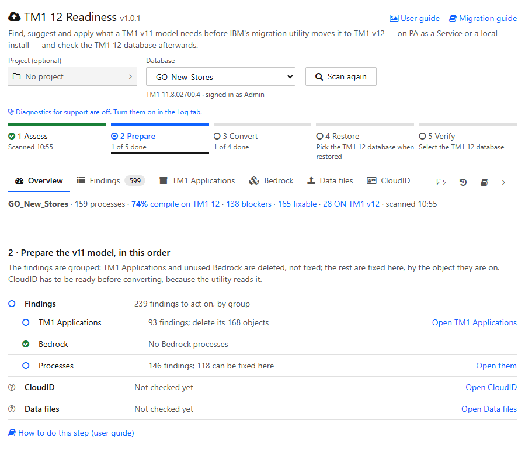
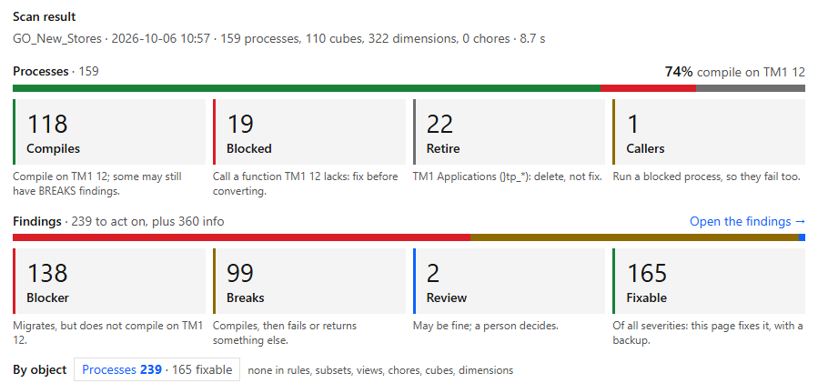
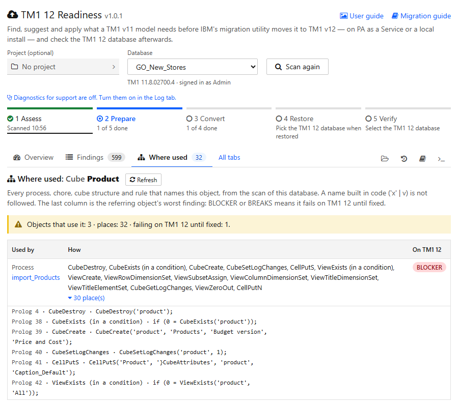
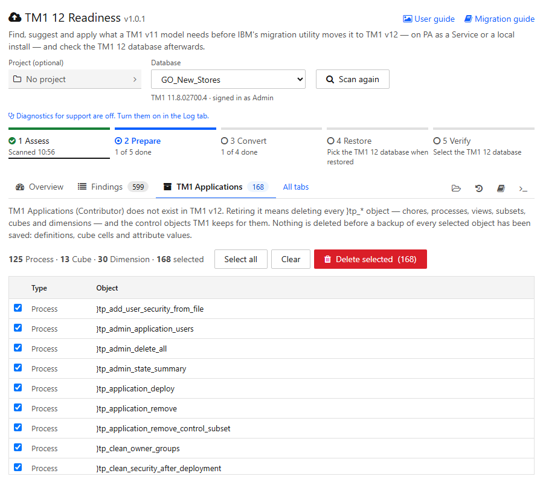
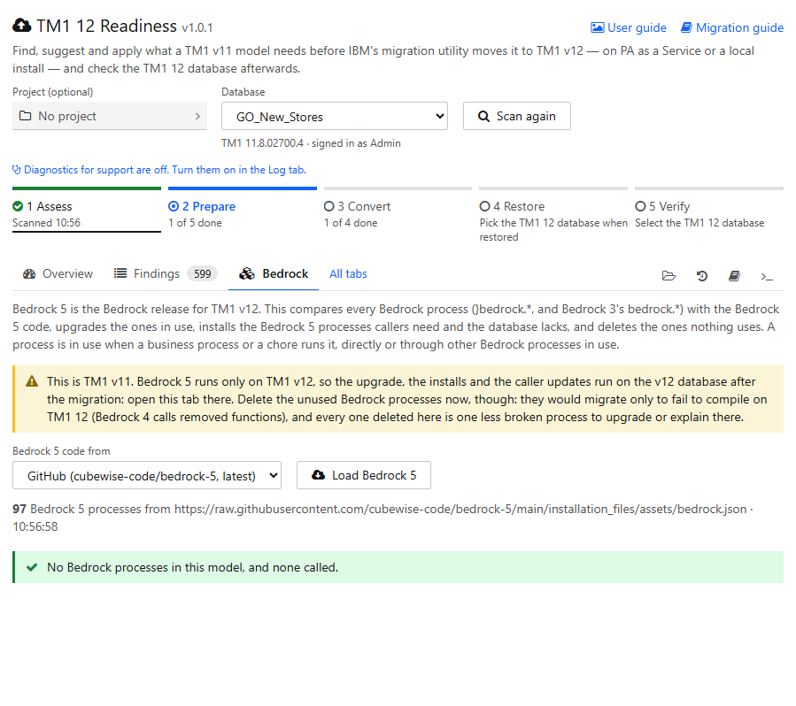
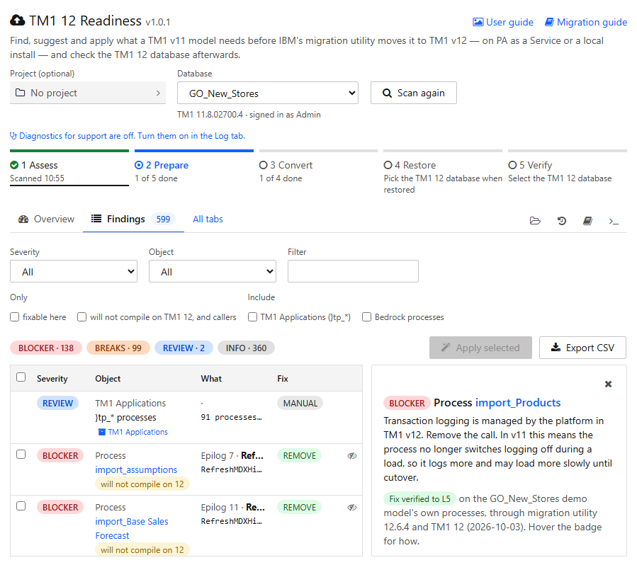
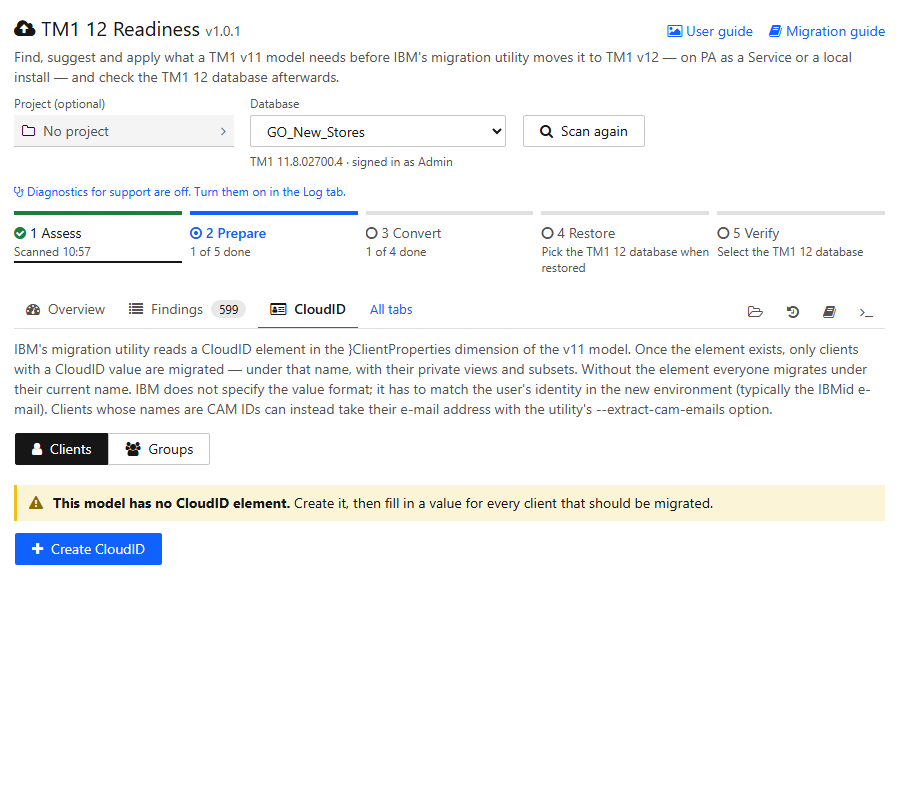
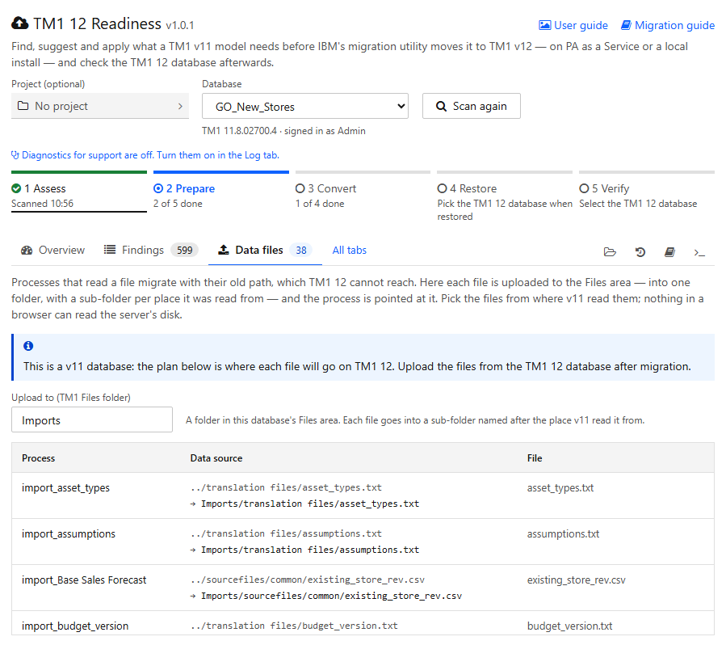
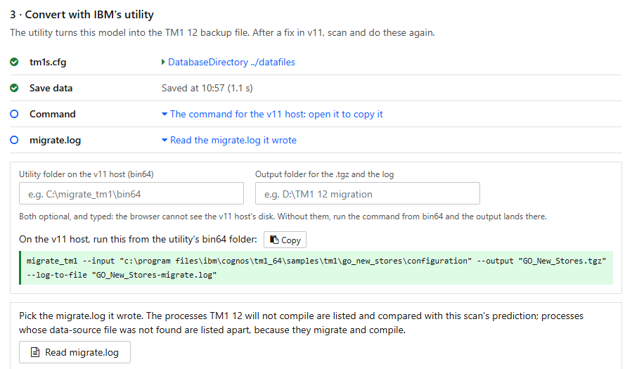
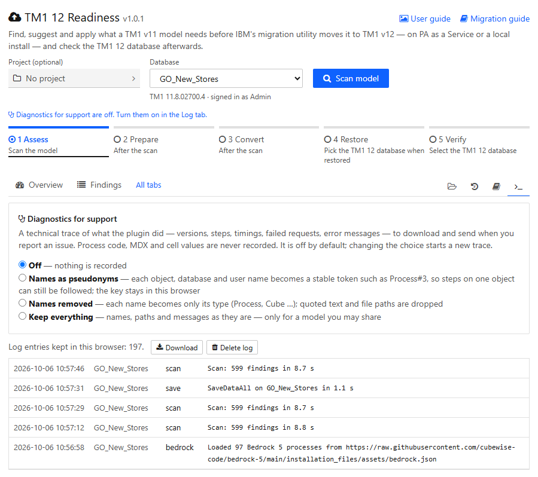

# TM1 12 Readiness — user guide

For TM1 12 Readiness **v1.0.1**, a plugin for Arc for TM1. It finds what a v11 model needs
before IBM's Database Migration Utility moves it to TM1 12, fixes what can be fixed safely,
and checks the TM1 12 database afterwards. The pictures are of the plugin on IBM's GO_New_Stores
demo model. Created by Muhammad Eissa, Cubewise.

The **migration guide** (`MIGRATION-GUIDE.html`, linked at the top right of the page) explains the migration itself:
what changes in TM1 12, the utility, and every rule behind a finding. This guide is about using the
plugin, in the order the migration needs it.

## Contents

- [The order of the work](#the-order-of-the-work)
- [Open it](#open-it)
- [Projects (optional): keep the work in a folder](#projects-optional-keep-the-work-in-a-folder)
- [Step 1 — Assess the v11 model](#step-1--assess-the-v11-model)
- [Step 2 — Prepare the v11 model](#step-2--prepare-the-v11-model)
- [Step 3 — Convert with IBM's utility](#step-3--convert-with-ibms-utility)
- [Step 4 — Create and restore the TM1 12 database](#step-4--create-and-restore-the-tm1-12-database)
- [Step 5 — Verify on TM1 12](#step-5--verify-on-tm1-12)
- [Backups and the log](#backups-and-the-log)
- [Diagnostics: reporting an issue](#diagnostics-reporting-an-issue)

## The order of the work

Each step needs the one before it. Steps 1–3 run on the **v11** database and step 5 on the **TM1 12**
database. Pick the v11 database in **Database** to start; step 4's **Switch to it and scan** moves the
page to the TM1 12 database once it is restored. The same five steps sit above the tabs, on
every tab, each with its state — done, current, blocked, or later. The **Overview** opens the
current one's checklist under a one-line summary of the scan; click any step, from any tab, to open
its checklist there instead.

The tabs under the steps are the **open step's** work areas — the step underlined above them — and
the tab you are on: Prepare shows TM1 Applications, Bedrock, Findings, CloudID and Data files;
Verify shows Findings, Bedrock and Data files; Convert and Restore need only the Overview. **All
tabs** shows every tab. **Project**, **Backups**, the **Guide** and the **Log** are the icons on the
right, on every step.

| Step | Database | Where | Needs |
|---|---|---|---|
| 1. Assess | v11 | **Scan model**, then step 1's v12 compile check | a TM1 12 database connected in Arc, for the compile check only |
| 2. Prepare | v11 | TM1 Applications → Bedrock → Findings → CloudID | the scan from step 1 |
| 3. Convert | v11 host | Step 3: tm1s.cfg → **Save data** → the command → **Read migrate.log** | step 2 done; `DatabaseDirectory` set |
| 4. Create and restore | TM1 12 | PAW, outside the plugin; then step 4's **TM1 12 database** row | the `.tgz` from step 3; the new database connected in Arc |
| 5. Verify | TM1 12 | Step 5 (scan, compare, compile check), Data files, Bedrock | the restore; the folder v11 read its files from |

When step 3's log shows a problem the scan did not predict, fix it on v11 (step 2) and convert
again. Fixing on v11 and converting again is better than fixing on TM1 12: the next conversion
would bring the problem back.

## Open it

- **Tools → TM1 12 Readiness** opens the page on a database.
- **Right-click a process, cube or dimension** in Arc's tree, then choose **Where used (TM1 12
  Readiness)**. The page opens on that object (see [Where used](#where-used)).

Pick the database in **Database**. The **Project (optional)** field before it keeps the work in a
folder (see [Projects](#projects-optional-keep-the-work-in-a-folder)). The line under **Database**
says the TM1 version and who is signed in, and shows **TM1 v12** when it is a TM1 12 database;
**Scan model** waits until the database has answered. If you are
not an admin it says so there, because Apply needs one. Apply, Save data,
CloudID changes, deletes and restores need an admin session. The **User guide** and the
**Migration guide** are linked at the top right; each step's checklist ends with a link to its part
of this guide.

## Projects (optional): keep the work in a folder

A project keeps one migration's work in a folder you choose, so you can stop and continue later, on
another day or another machine, or hand it to a colleague. It is optional: without a project the
plugin works exactly as before.

**What a project keeps.** The last three scans of each database, the step status (data saved, the
command copied and its two folders, the `migrate.log` you read, the TM1 12 database picked in step 4,
the compare and the TM1 12 compile check), the folder's path on the v11 host, skipped findings,
exports, every backup, and the log.

**Start a project.** Click the **Project (optional)** field, first in the bar beside **Database**
(or the folder icon on the right of the tabs), then **New project**. Give it a name, pick the v11 database and, once it exists, the TM1 12
database, and **Choose folder** — an empty or new folder. Your browser asks once to let the plugin
save there. *Add what this session already has* is ticked already, so the scan, backups and log you
have come with it; untick it to start empty. The project's name then stays in the field, and the
line under it says whether the work is saved, for example *Saved to project · 10:42*.

On the Project tab, type the folder's **Path on the v11 host** once: the browser knows the folder
only by its name. With the path set, step 3's command writes into the project's `migration` folder
and the log is read from there.

**The line under the field** speaks only when there is something to say: *Keep your work in a
folder · Start one* before you have used projects; *GO_New_Stores migration
has this database · Continue* when a project you used before holds the database you picked;
*Not saved · Keep it in a project* after a scan without a project (the scan note offers the same,
and it brings the scan, backups and log you already have); *Your 5 Oct scan wasn't kept* when a
scan was lost on a reload. Those reminders stop after two sessions if you never use projects;
the line is then empty and the field reads *No project*.

**Continue a project.** Click **Continue** under the field when it offers the project, click it
under **Recent projects** on the Project tab, or **Open a project folder** and pick the folder. The
page moves to the project's database, unless the one on screen is the project's or has a scan, and
shows its last scan at once with the note *From the project, scanned …*. As soon as the database
answers, the plugin scans it again by itself (it only reads), and the note then says what changed
since the save. Until the fresh scan is in, the buttons that write from the scan are disabled
(Apply, the deletes, Grant READ, Bedrock's Apply, Upload and update, Replace). If the database does
not answer, for example because it is not signed in, the note offers **Scan again**.

**When the browser asks again.** After the browser restarts, a line under the bar asks to
**Allow access to the folder again** (the field's line offers the same). One click, and saving resumes. Until then the plugin works
but saves nothing to the project.

**When something is wrong.**
- *The project folder can't be found* — it was moved or renamed: **Find the folder** and pick it
  where it is now.
- *This folder has no project in it* — pick the project's own folder (the one with `project.json`),
  or start a new project there.
- *Saved by a newer version* — update the plugin first; an older one does not open it.
- *Open in another browser window* — one window at a time saves to a project.

**Without folder access.** Folder access needs Edge or Chrome, with Arc opened as `localhost`. Elsewhere
the project is kept in this browser instead: **Download project file** when you stop, and
**Open a project file** to continue. Backups are downloaded as well, so they never live only in the
browser.

**Sharing a project.** Copy the folder. It holds no passwords or connections, but it does hold the
model's process code and the backups' original values — treat it like the model itself. Do not use
the plugin's own install folder: a reinstall replaces it, and Arc serves its files.

The folder holds `project.json` (what the project is), `log.jsonl`, and the folders `scans/`,
`backups/`, `results/`, `skips/`, `inputs/` and, once the path on the v11 host is set, `migration/`
(the utility's output). A backup in `backups/` is the same file a download would be, so it also
restores through **Restore from a backup file**.

## Step 1 — Assess the v11 model

**Scan model** reads the processes, rules, subsets, views, chores and the server's `tm1s.cfg`, and
checks them against what TM1 12 accepts. It reads only; nothing is written. On GO_New_Stores it
takes about 7 seconds. The first scan of a database opens step 1, where the result is, with a line
that sums it up and **Next: Prepare**. A rescan leaves you where you are and says in one line what
changed — blockers, compile share, fixable — with a link to the result.

The scan's result is in step 1's panel: two rows, each with a bar and four tiles of the same size.
A row counts one thing only, and the line under each tile says what it means. A tile with a list
behind it opens it.

**Processes**, with the share that compiles on TM1 12 as the score at the right:

- **Compiles**: compiles on TM1 12. Some of these still have BREAKS findings.
- **Blocked**: calls a function TM1 12 does not have, so it migrates but does not compile. Fix it
  before converting.
- **Retire**: a TM1 Applications process (`}tp_*`). TM1 Applications does not exist in TM1 12, so
  these are one decision in step 2 — delete them — not hundreds of fixes.
- **Callers**: runs a blocked process, so it fails too.

Blocked and Retire together are what the migration utility reports as not compiling: 41 on
GO_New_Stores.

**Findings**, counted one per statement:

- **Blocker**: TM1 12 will not compile the process. The migration carries it over broken.
- **Breaks**: it compiles, but fails or gives a different result on TM1 12.
- **Review**: may be fine; a person decides. **INFO** findings are counted beside the row label.
- **Fixable**: what this page can fix, with a preview and a backup — of every severity, so it is
  not a fourth slice of the bar.

**By object** splits the same findings to act on by what they are on: processes, rules, subsets,
views, chores, cubes and dimensions. Only the types with findings get a count, and one line names the
rest ("none in rules, subsets, …"); a count opens the Findings tab filtered to it. Step 2's checklist
uses the same types as its groups.

**The v12 compile check** needs a TM1 12 database connected in Arc — any one; nothing is saved
there. Open step 1's **Compile check** row (it says whether the check has run) and click **Run v12
compile check**. It sends every process of this model to the
real TM1 12 compiler, so it also catches what a list of function names misses. Allow about 4 seconds a
process on PA as a Service.

### Where used

Use it before you change or delete anything in step 2. Opened from Arc's tree, it lists every
process, chore, cube structure and rule that names the object. Each row is one referring object,
with the functions it uses (open **places** to see every line). **On TM1 12** shows that object's
worst finding: a BLOCKER or BREAKS there means it fails on TM1 12 until it is fixed. A name built in
code (`'x' | v`) is not followed.

## Step 2 — Prepare the v11 model

Step 2's checklist puts the **findings** first, as a total over their groups: **TM1 Applications**
and unused **Bedrock** processes are deleted, not fixed; the rest are fixed here, one group per object
type that has findings (**Processes**, **Rules**, **Subsets**, **Views**, **Chores**, **Cubes**,
**Dimensions**, and **Others** for any object of a type the scan does not name). Then come **CloudID**
and the **data-file plan**. Deleting before fixing saves work: every object deleted is one
fewer to fix.

### 1. TM1 Applications

TM1 Applications does not exist in TM1 12, so decide first whether it is retired. The tab lists
every `}tp_` object, and anything else that still uses one. **Delete selected** backs them up first
(*Back up, then delete*), then deletes in dependency order. TM1 does not let anyone, an admin included, read the cells of some of
these cubes: they are listed, backed up without their cells, and deleted only after you tick a box.

An object counts as deleted only when TM1 itself answers that it is gone. This holds for every
delete on the page, Bedrock's and *Delete this process* included. If an answer does not come from
TM1 (no answer in time, or a dropped connection), the plugin says it does not know whether that
object was deleted. Two such answers in a row stop the run, and so does a sign-in problem. Nothing
more is deleted, and the backup holds everything: scan again, then run it again.

### 2. Bedrock

Compares the model's Bedrock processes with Bedrock 5 and follows which ones your own processes
call. **Delete the unused ones now**: Bedrock 4 calls functions TM1 12 does not have, so each would
migrate only to fail to compile. The ones in use are upgraded to Bedrock 5 on the TM1 12 database,
in step 5. Hover a status for what it means.

### 3. Findings and Apply

- **Filter** by severity (*To act on* is every severity but INFO), by object type, by text, or to what Apply can fix. TM1 Applications (`}tp_*`) and
  Bedrock processes are hidden unless you include them; they have their own tabs.
- **Click a row** to open it. The panel says what the finding means and what to do.
- **Object names are links**: a click opens the process, chore, cube (its rules), dimension,
  subset or view in Arc, in a tab of its own; the Findings tab keeps its scan.
- **Column widths**: drag the right edge of a column header; double-click it to put every column
  back. The widths are remembered in this browser.
- **Fix verified to Lx** says how far that kind of fix has been taken through the real migration:
  applied on v11, converted by IBM's utility, restored on PA as a Service and run there. **L5**
  means it gave the same result as v11. Hover the badge for the evidence. *After Apply* names
  anything left to do by hand.
- **What Apply will change** is the exact diff.
- **Apply to this object** — or tick several rows and **Apply selected**. Each process is backed up
  to your Downloads folder (or, with a project open, to its `backups/` folder), dry-run compiled,
  written, read back and compiled again. If anything
  fails, the original is put back. A bulk run stops at the first failure. While a scan read back
  from a project is on screen, both Apply buttons are disabled; hover one for why.
- A process Apply cannot fix safely is shown **MANUAL**, not as a fix, and is not counted as
  fixable. Taking its statement out would break a later line that still uses what it sets. Open it
  to see the lines that block it, change them by hand, then scan again.
- **Skip this finding** (or the eye icon on its row) when you will handle it yourself: Apply then
  leaves that statement alone, and ticking **skipped** under *Include* brings it back. Skips are kept per database in
  this browser, and in the project when one is open.

Apply writes to the live database. On v11, that changes how the model behaves until cutover —
each finding says how. **Scan again** when you are done, so step 3 compares the log with the model
as it now is.

### 4. CloudID

Prepare the name each client — and each group — will have on TM1 12: edit, import or export a CSV.
It has to be done **before** step 3: the utility reads it while converting, and once the CloudID
element exists only clients with a value migrate. Restore from the Backups tab.

### 5. Data files: the plan

On v11 the tab shows the plan only: each process that reads a file, and where that file will go on
TM1 12. The upload itself is step 5, and it needs **the folder v11 read the files from** — keep it.

In **Findings**, a process whose data-source path TM1 12 cannot use (an absolute, network or `..`
path) is tagged **ON TM1 v12**: there is nothing to change on v11, because in step 5 this tab uploads
the file and points the process at it, and the finding closes on the next scan after the upload.
The summary line counts them (*"28 ON TM1 v12"* on GO_New_Stores), and the count opens Data files;
the finding's panel offers *Open Data files*. On the TM1 12 database the same findings read
*"N ON TM1 v12 to do"*. A process that sets its data source in its own code stays **MANUAL**:
the tab cannot repoint that one, so change the path in the code.

## Step 3 — Convert with IBM's utility

The plugin prepares the model; **IBM's Database Migration Utility** converts it into the TM1 12
backup file (the migration guide says where to download it). Step 3's checklist on the Overview
lays out the conversion in order. Each row is its own control: the text of *tm1s.cfg*, *Command*
and *migrate.log* opens and closes that row's section under the list, and the text of *Save data*
runs it.

1. **tm1s.cfg** — read by the scan, no file to pick. The line is **red** when `DatabaseDirectory`
   is missing: the utility will not run without it, so fix that first. Otherwise it shows the
   directory and how many parameters TM1 12 does not support; *Show* lists them. Those are dropped,
   and on PA as a Service the configuration is set in PA Administration.
2. **Save data** runs SaveDataAll on the selected database: click the row's text. The utility reads
   the files on disk, not the server's memory, so anything not yet saved would not migrate. It asks
   first: on a large model the server is busy until it finishes. The row then shows when it saved.
3. **The command**, worked out from the server for this model — open the row, **Copy** it (a copy
   by hand ticks the row too) and run it on the v11 host, from the utility's `bin64` folder. A
   relative output file is written next to the utility and the log next to where you run it, so
   running it from `bin64` keeps them together. The utility needs free disk of at least 2.5× the
   database size, plus RAM to load it.

   Or type the **utility folder** and the **output folder** on the v11 host above the command: it
   then names both in full and runs from anywhere. They are typed because the browser cannot see that
   host's disk, and they are remembered for the database (and in the project). Changing either one
   un-ticks the row: copy the command again. In a project, give the project folder's **path on the
   v11 host** once (asked here, or on the Project tab): the output then defaults to its `migration`
   folder (the field reads *Empty: the project's migration folder, …*), and item 4 reads the log
   from there.
4. **Read migrate.log** — open the row and pick the log the command wrote, or, in a project whose
   output went to its `migration` folder, **Read the log in the project's migration folder**: no file
   to pick, and the plugin checks the `.tgz` is there too. A verdict comes first:
   *Clear to go*, *Step 4 can start, with N things to do*, or *Not ready for step 4*, and one line
   for each thing, tagged **Stops step 4**, **To do**, **On TM1 v12** (the Data files tab does it, in
   step 5) or **Nothing to do** (with why). *N things to do* counts the To do and On TM1 v12 lines.
   Below it, the processes TM1 12 will not compile, compared with what
   the scan predicted, and the processes whose data-source file was not found, which migrate and
   compile. *"Subset element not found, ignoring"* is one of the *Nothing to do* lines: a static
   subset names an element its dimension no longer has, which v11 already leaves out. Old-format
   feeder files are a **To do** line: TM1 12 rebuilds the feeders from the rules, so a
   rule-calculated cell whose rule has no feeder drops out of NON EMPTY views (on GO_New_Stores,
   120 New Store Index cells). Check that every rule that needs one has a feeder before cutover;
   saving data on 11.8 did not rewrite the files.

If the log names something the scan did not predict, go back to step 2, fix it, and convert again.

## Step 4 — Create and restore the TM1 12 database

Create and restore it outside the plugin, in PAW: **Administration → Databases → Create**, with
**exactly the v11 name** and at least the v11 RAM and CPU; then **Backup → Upload** the `.tgz` →
**Restore**. The migration guide's step 4 has the details. Then hand the page over to it:

1. Connect the new database in Arc.
2. In step 4's checklist, pick it in the **TM1 12 database** row (*Not restored yet* until you do;
   a database that is not listed needs its connection added in Arc first). The plugin checks its
   version; a database that is not TM1 12, or not signed in, is said so on the row.
3. Click **Switch to it and scan**: the page moves to the TM1 12 database and scans it, the v11
   database stays as the one to compare with, a project records it as its TM1 12 database (asking
   first if it names another), and the page opens **Data files** when there are files to upload,
   otherwise step 5.

## Step 5 — Verify on TM1 12

After **Switch to it and scan** (step 4) the TM1 12 database is picked and scanned, and v11 is
already the database to compare with. Without it, pick the TM1 12 database in **Database** and click
**Scan model**.

- **The scan**: on TM1 12 the tiles count what fails there now, and step 5 is the current
  step: steps 1–3 read *Done on v11*. The summary line counts the files still to upload
  (*N ON TM1 v12 to do*), and the scan note offers **Upload data files (N)**.
- **Compare with the original v11 database** (step 5; *Original v11 database* is already filled in
  after **Switch to it and scan**): what v11
  has that this database lacks was not migrated — a name the utility rejects, a rejected
  dimension, a failed step. Each missing process is scanned on v11, so it shows what it calls that
  TM1 12 does not have.
- **The compile check** on this database dry-runs its own processes against its own compiler.
- **Bedrock**: upgrade the processes in use to Bedrock 5, install the ones callers need, update
  the callers.
- **Data files**: upload the files, below. Step 5's row says how many are left (*N data files to
  upload*).

### Data files: the upload

A process that reads a file migrates with its old path, which TM1 12 cannot reach. On the **TM1 12
database**, after the restore:

1. The tab lists each such process, and where its file will go: one folder (`Imports` — rename it
   if you like), with a sub-folder per place the file was read from.
2. **Drop the folder** v11 read the files from onto the drop zone, or **choose a folder** (or
   **choose files**) there. A folder is better: two files with the same name in different
   sub-folders are told apart by their path. A browser cannot read the server's disk, so this step
   is yours.
3. Every process a file was found for is **ticked**; untick any you want to leave out. *Upload to*
   is the folder in the database's Files area the files go into.
4. **Upload and update** backs the ticked processes up, uploads each file exactly, checks its size,
   and points the process at it.
5. Each row then shows its **result**, and one line above the table sums it up. Rows that need
   attention come first; the chips above the table filter by *Needs attention*, *Not picked*,
   *Ready* and *Done*.

The tab reads TM1 12's Files area each time it opens, so what is already done stays done after a
rescan, a reload, or a new *Upload to* folder: a process that reads a file that is there shows
**On TM1 12 · in use**, and one whose file is gone shows **File missing on TM1 12**.
*Check again* reads it afresh.

When a picked file differs from the one already on TM1 12, the row shows **Differs from TM1
12** with **Compare** beside it, and a note above the table names it too (its *Compare*
opens the comparison directly). The comparison shows both files' size, lines, encoding and line ends,
then the lines that differ. **Replace with the picked file** saves the file on TM1 12 and the
processes that read it to the backup first, then uploads the picked file, checks its size, and
points the process at it. Restoring that backup puts the old file back, byte for byte.

A file already there with the same size is used as it is. A different one is never uploaded over by
**Upload and update**: only **Replace with the picked file**, above, does that. Restoring the backup
puts each data source back and deletes only the files that were uploaded, never a folder.

## Backups and the log

- **Backups** (the clock icon on the right of the tabs) lists every backup taken in this session; each is also a file in your Downloads
  folder — or, with a project open, in the project's `backups/` folder, where the list keeps them
  across sessions. **Restore** puts the objects back. **Restore from a backup file** reads an older one.
- **Log** keeps what the plugin did, in this browser (and in the project's `log.jsonl` when one is
  open) — including each Save data — download it, or delete it.

## Diagnostics: reporting an issue

When something goes wrong, a technical trace helps us find and fix it. Diagnostics are **off** by
default, and a line under the database picker says so until you turn them on in the Log tab:

- **Off** — nothing is recorded.
- **Names as pseudonyms** — each object, database and user name becomes a token such as
  `Process#3`. Steps on one object can still be followed. The key stays in your browser.
- **Names removed** — each name becomes only its type (`Process`, `Cube` …). Quoted text and file
  paths are dropped.
- **Keep everything** — names, paths and messages as they are. Only for a model you may share.

The trace holds versions (plugin, Arc, TM1, browser), the steps you took, timings, failed requests
with their messages, and counts. **Process code, MDX and cell values are never recorded.**
**Download diagnostics** saves one file; send it with your report. Changing the choice starts a new
trace, so one file never mixes two levels of detail.

---

TM1 12 Readiness v1.0.1 — Created by Muhammad Eissa, Cubewise.
